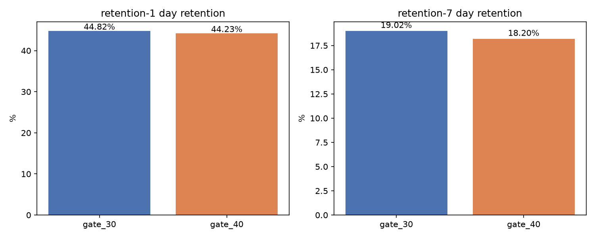
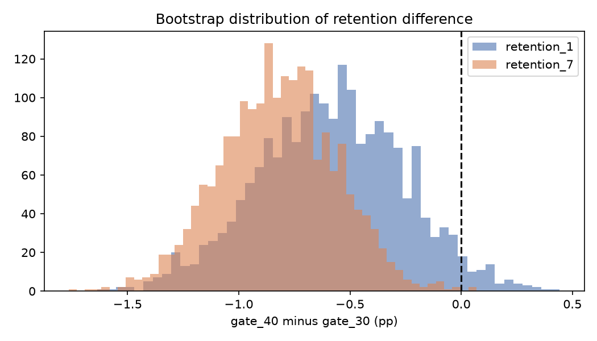
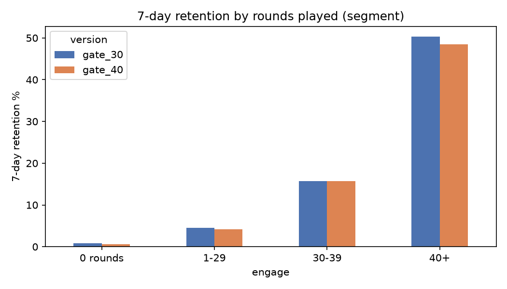

# Cookie Cats A/B Test — Should the first gate move from level 30 to level 40?

## Business question
Cookie Cats (a mobile puzzle game by Tactile Entertainment) forces players to wait or pay at "gates". An A/B test moved the first gate from **level 30 (control)** to **level 40 (treatment)**. Did it change player retention 1 and 7 days after install?

## Data
- 90,189 players, randomly assigned at install. Columns: `userid`, `version`, `sum_gamerounds`, `retention_1`, `retention_7`.
- Source: Cookie Cats dataset (originally released for a DataCamp project by Tactile Entertainment), mirrored at https://raw.githubusercontent.com/ryanschaub/Mobile-Games-A-B-Testing-with-Cookie-Cats/master/cookie_cats.csv
- Licence: no explicit licence is attached to the mirror; widely shared for educational use. Used here for non-commercial learning only.

## Method
1. Cleaning: checked duplicates (0) and missing values (0); removed one extreme outlier (49,854 rounds).
2. Sanity check: sample ratio mismatch (chi-square).
3. Retention per group, two-proportion z-test, 95% CI for the difference.
4. Power / minimum detectable effect (80% power, α = 0.05).
5. Bootstrap (2,000 resamples) CI and a Bayesian Beta-Binomial estimate.
6. Segment look by rounds played.

## Results
| Metric | gate_30 | gate_40 | Diff (pp) | p-value | 95% CI (pp) | P(gate_30 better) |
|---|---|---|---|---|---|---|
| 1-day retention | 44.82% | 44.23% | -0.59 | 0.074 | [-1.24, 0.06] | 96.2% |
| 7-day retention | 19.02% | 18.20% | -0.82 (-4.3% relative) | 0.0016 | [-1.33, -0.31] | 99.9% |

- Bootstrap CIs agree: 1-day [-1.26, 0.05] pp, 7-day [-1.33, -0.33] pp.
- MDE at this sample size: ~0.93 pp (1-day), ~0.73 pp (7-day). The 7-day effect is above the MDE (power ≈ 88%); the 1-day effect is not (power ≈ 43%).
- Sample ratio: 44,699 vs 45,489 (SRM p = 0.0085), a small imbalance worth flagging to the engineering team.
- Segments: gate_30 has equal or higher 7-day retention in every rounds-played band; the biggest gap is among players with 40+ rounds (50.3% vs 48.5%).





## Recommendation
**Do not ship gate_40. Keep the gate at level 30.** Moving it to level 40 lowers 7-day retention by about 0.8 percentage points, a result that is statistically significant and robust across frequentist, bootstrap and Bayesian checks.

## Limitations
- Small sample ratio mismatch: the assignment process should be checked before fully trusting the result.
- Retention only; there is no revenue or in-app purchase data, so the effect on monetisation is unknown.
- Segments are based on rounds played, which happen *after* assignment, so they are descriptive, not causal.
- Fixed historical data; no information on test duration or novelty effects.

## Reproduce
```bash
pip install -r requirements.txt
python analysis.py   # prints results, writes results.txt and charts/
```
